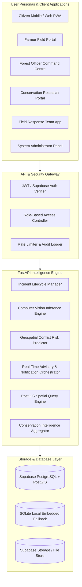

# WILDSHIELD AI — System Architecture Specification

## 1. Executive Overview
WILDSHIELD AI is an enterprise-grade wildlife intelligence, human-wildlife conflict prevention, and conservation ecosystem designed for forest departments, rural communities, agricultural operators, researchers, and emergency response teams.

---

## 2. Five Core Architectural Pillars

### A. Modular Service Decomposition
- **Incident Lifecycle Management**: State machine tracking `SUBMITTED -> UNDER_REVIEW -> VERIFIED -> ASSIGNED -> RESPONDING -> RESOLVED` (and terminal states `REJECTED`, `DUPLICATE`, `CANCELLED`).
- **Computer Vision Service**: Dual-stage species identification pipeline with confidence thresholds, bounding box metadata, and uncertainty estimation.
- **Risk Prediction Engine**: Explainable area-level conflict forecasting combining historical incident density, proximity to farmland/settlements, seasonal patterns, and time decay.
- **Real-Time Notification Dispatch**: Tiered alert dissemination respecting quiet hours, geographic geofences, and role jurisdictions.
- **Geospatial Engine**: PostGIS-compatible spatial indexing, clustering, and privacy-preserving coordinate generalisation for endangered species.

### B. Security & Row-Level Authorization
1. **Citizens & Farmers**: Access restricted strictly to own reported incidents, public verified alerts, and generalised non-sensitive species sightings.
2. **Forest Officers**: Scoped to jurisdiction, authorized to verify reports, approve alerts, and assign field teams.
3. **Response Teams**: Access restricted to assigned active incidents with tactical operational coordinates.
4. **Researchers**: Access to aggregated, anonymized research datasets with sensitive breeding/nesting coordinates masked.
5. **Administrators**: System health, model registry, audit logs, and account lifecycle management without ability to delete audit trails.

### C. Zero-Interruption Dual-Persistence Strategy
- **Cloud Mode**: Supabase PostgreSQL with PostGIS extensions, Supabase Auth, and Storage.
- **Offline/Local Resilience**: Embedded SQLite dialect mapping with spatial math fallback, allowing the entire system to run and be tested offline without external cloud dependencies.

### D. Responsible & Explainable AI
- Every risk prediction produces traceable `contributing_factors` (e.g. "Elevated risk estimate because the area has 4 recent verified elephant sightings within 3 km and a history of autumn crop harvesting overlap").
- Computer vision returns high/medium/low confidence tiers, explicitly highlighting "Unable to identify confidently" below thresholds to prevent false alarms.

---

## 3. Technology Stack & Directory Structure
- **Frontend**: React 18, TypeScript, Vite, Tailwind CSS, React Router v6, React Leaflet, Recharts, Lucide Icons, Framer Motion.
- **Backend**: Python 3.13, FastAPI, Uvicorn, SQLAlchemy 2.0, Pydantic v2, Scikit-learn, OpenCV, PyTorch.
- **Database**: PostgreSQL / SQLite hybrid abstraction layer with complete relational schema.
