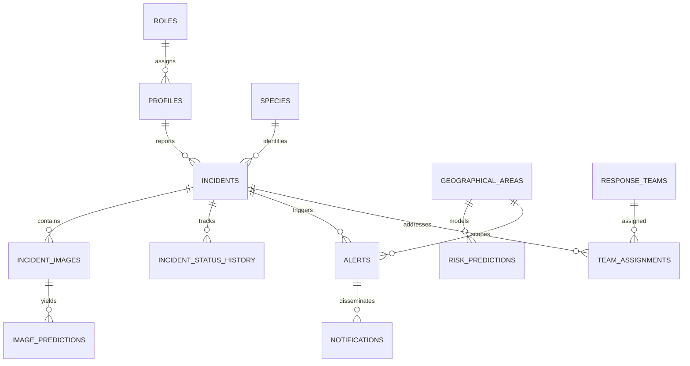

# WILDSHIELD AI — Database Architecture & Entity Specifications

## 1. Engine & Relational Design
WILDSHIELD AI uses a strict relational architecture with UUID primary keys, indexed foreign key relationships, temporal tracking, check constraints, and JSONB document storage for flexible telemetry attributes.

- **Production Target**: Supabase PostgreSQL with PostGIS spatial extension.
- **Local Fallback**: Embedded SQLite dialect mapping for zero-dependency local development and automated CI/CD testing.

---

## 2. Relational Entity ERD (Core Tables)

---

## 3. Schema Summary
1. `roles`: Role definitions and JSON array permissions.
2. `profiles`: User accounts, contact details, preferred language, and account status.
3. `species`: Native wildlife taxonomy, IUCN conservation status, identification marks, and safety guidance.
4. `geographical_areas`: Monitored conservation buffers, boundaries, center coordinates, and privacy classifications.
5. `incidents`: Sighting reports, crop damage logs, GPS coordinates, severity, and verification lifecycle.
6. `incident_images`: Stored image files, mime types, and file sizes.
7. `image_predictions`: Computer vision outputs, confidence tiers, bounding boxes, and model versions.
8. `incident_status_history`: Immutable audit trail of every status transition with officer notes.
9. `wildlife_observations`: Verified animal observations for conservation research.
10. `risk_predictions`: Area-level conflict forecasts with explainable factors and model uncertainty.
11. `alerts`: Official safety advisories issued by authorized forest rangers.
12. `notifications`: Personal notifications delivered to citizens and farmers.
13. `response_teams`: Rapid conflict response units (RCRT) and operational readiness.
14. `team_assignments`: Field dispatch assignments, priority tiers, and resolution notes.
15. `audit_logs`: Append-only security audit log protecting against administrative tampering.
16. `model_versions`: Registry tracking active AI/ML model versions, datasets, and benchmark metrics.
